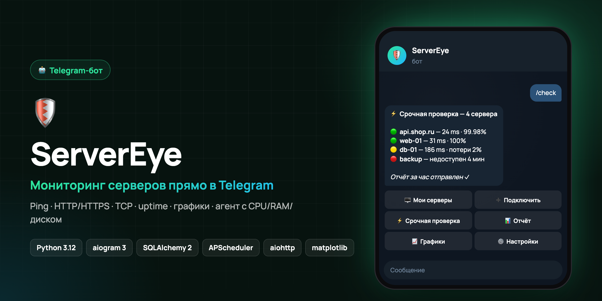

<div align="center">



# ServerEye

**Telegram-бот мониторинга серверов**

     

*🇬🇧 Telegram bot for server monitoring — Ping/HTTP/TCP checks, uptime stats, charts, hourly reports, alerts and an optional agent reporting CPU/RAM/disk.*

</div>

---

**Мониторинг доступности серверов в Telegram.**

ServerEye проверяет ваши серверы по Ping, HTTP/HTTPS и TCP-портам, хранит
историю проверок, считает uptime и статистику, сравнивает свежие показатели
с прошлыми и присылает уведомления, когда сервер упал, восстановился или
начал отвечать заметно медленнее.

Дополнительно (опционально) на сервер можно поставить **ServerEye Agent** —
небольшой сервис, который отдаёт боту CPU, RAM, диск, сетевой трафик и uptime
системы.

---

## Возможности

| Раздел | Что делает |
|---|---|
| 🖥 Мои серверы | Список со статусами, карточка сервера, ping, uptime за 24 ч / 7 д / 30 д |
| ➕ Подключить сервер | Пошаговый мастер: название → адрес → тип проверки → порты |
| ⚡ Срочная проверка | Немедленный параллельный опрос всех серверов с живым прогрессом |
| 📊 Статистика | Проверки, ошибки, эпизоды недоступности, uptime, min/avg/max ping |
| 📈 Графики | Ping и Uptime за 24 часа, 7 и 30 дней (плюс CPU/RAM/Disk при наличии агента) |
| 🧠 Состояние системы | Общая сводка по всем серверам |
| 📊 Отчёты | Ежечасный и ежедневный отчёт, а также отчёт по кнопке |
| 🔔 Уведомления | Down/Up, высокий ping, потери пакетов, CPU/RAM/Disk, перегрев, пропажа питания, аналитика |
| 🌡 Железо | Температура CPU и GPU, заряд батареи, работа от сети или батареи |
| ⏻ Выключение | Кнопка выключения машины, на которой работает бот (только администратор) |
| ⚙️ Настройки | Пороги, часовой пояс, отчёты, удаление своих данных |
| 👑 Админ-панель | Пользователи и кто сейчас в боте, заявки, одноразовые приглашения, журнал доступа |

Статусы везде одинаковые: 🟢 норма · 🟡 внимание · 🔴 критично · ⚪ нет данных.

---

## Быстрый старт

```bash
python3 -m venv .venv
source .venv/bin/activate          # Windows: .venv\Scripts\activate
pip install -r requirements.txt

cp .env.example .env               # впишите BOT_TOKEN от @BotFather
python -m servereye.main
```

В Telegram отправьте боту `/start`.

### Основные переменные окружения

| Переменная | По умолчанию | Смысл |
|---|---|---|
| `BOT_TOKEN` | — | токен бота, **обязателен** |
| `DATABASE_URL` | `sqlite+aiosqlite:///./servereye.db` | БД (SQLite из коробки) |
| `SERVER_CHECK_INTERVAL_MINUTES` | `60` | как часто проверяются серверы |
| `MAX_CONCURRENT_CHECKS` | `10` | предел параллельных проверок |
| `HOURLY_REPORT_MINUTE` | `0` | минута часа, в которую уходит отчёт |
| `DAILY_REPORT_HOUR` | `9` | час ежедневного отчёта |
| `AGENT_API_PORT` | `8787` | порт HTTP API для агентов |
| `DATA_RETENTION_DAYS` | `45` | срок хранения истории |
| `ADMIN_IDS` | — | **обязателен**: Telegram ID владельца — доступ к боту, админ-панель, кнопка выключения |
| `POWER_CONTROL_ENABLED` | `false` | включить кнопку «⏻ Выключить сервер» |
| `TEMP_ALARM_REPEAT_MINUTES` | `3` | как часто повторять тревогу о перегреве |
| `TEMP_ALARM_CLEAR_DELTA` | `5` | насколько ниже порога должно остыть, чтобы тревога снялась |
| `BATTERY_ALERT_LEVELS` | `20,10,5` | уровни заряда для предупреждений при работе от батареи |

Если интервал проверки укладывается в час целое число раз, расписание
выравнивается по часам (при 60 минутах проверка идёт в :50) — так ежечасный
отчёт в :00 всегда опирается на свежие данные.

---

## Архитектура

```
servereye/
├── bot/
│   ├── handlers/        common, add_server, servers, urgent, settings
│   ├── keyboards/       inline-клавиатуры
│   ├── middlewares/     сессия БД, пользователь, троттлинг
│   └── texts.py         все тексты интерфейса
├── services/
│   ├── server_monitor.py   ICMP / HTTP / TCP-проверки
│   ├── pipeline.py         проверка → БД → анализ → уведомление
│   ├── analyzer.py         сравнение с историей, человеческие выводы
│   ├── notifier.py         отправка с ретраями и тихими часами
│   └── charts.py           графики (matplotlib, Agg)
├── database/            models.py, repository.py, database.py, migrations.py
├── scheduler/tasks.py   APScheduler: проверки, отчёты, сторож агента, очистка
├── api/agent_api.py     HTTP API приёма метрик нагрузки
├── agent/               ServerEye Agent (ставится на сервер)
├── config.py            Pydantic-настройки из .env
└── main.py              точка входа
```

Принципы:

* **Сеть отдельно, БД отдельно.** Сетевые проверки идут параллельно и без
  обращения к базе; результаты пишутся последовательно в одной сессии.
* **Права на каждое действие.** Смотреть сервер может любой участник с
  доступом, менять — только автор, админ или владелец; проверка стоит в
  каждом обработчике, поэтому подделанный callback ничего не даст.
* **Расширяемость.** Новый тип проверки добавляется в `server_monitor.run_check`,
  новые метрики — полем в `ServerMetric` и парой строк в агенте.
* **Миграции.** `database/migrations.py` — идемпотентные шаги, применяются при
  старте и приводят существующую базу к текущей схеме.

### Схема данных

`users` · `settings` · `servers` · `server_checks` · `server_metrics` ·
`notifications` · `agent_events`

Всё привязано к Telegram `user_id`, история чистится по `DATA_RETENTION_DAYS`.

---

## ServerEye Agent (опционально)

Ping, HTTP и TCP показывают только доступность. Чтобы видеть нагрузку, на
сервер ставится агент — он собирает метрики и отправляет их боту по токену.

```bash
pip install psutil httpx
python servereye_agent.py --server http://ВАШ_АДРЕС:8787 --token SE-xxxxxxxxxxxxxxxx
```

Токен выдаётся при подключении сервера (шаг «🖥 Мониторинг ресурсов»).
Агент не выполняет команд и не требует root. Юниты systemd —
в [deploy/](deploy). Состояние агента отслеживается отдельно от доступности
сервера: сервер может отвечать, а агент быть остановлен — бот скажет об этом
разными сообщениями.

---

## Закрытый доступ и приглашения

Бот закрытый. Владелец — Telegram ID из `ADMIN_IDS`; все остальные попадают
в бот только по его личному приглашению (👑 Админ-панель → ➕ Пригласить).

**Как устроены приглашения**

* ссылка одноразовая: гаснет при первом входе, повторно по ней не войти;
* у ссылки есть срок жизни — 1 час, 24 часа или 7 дней;
* режим **«с подтверждением»** (рекомендуется): человек отправляет заявку,
  владелец видит его имя, @username и ID и нажимает «Пустить» или «Отказать».
  Это единственная настоящая защита от пересылки ещё не использованной
  ссылки — владелец видит, кто пришёл на самом деле;
* режим **«сразу»**: доступ открывается мгновенно, владельцу приходит
  уведомление с кнопкой «Забрать доступ»;
* в ссылке 256 бит случайности, в базе хранится только SHA-256 —
  по утёкшей базе ссылку не восстановить;
* погашение атомарное: если двое нажмут ссылку одновременно, войдёт один;
* владелец может нажать свою ссылку для проверки — она не сгорит.

**Что закрыто**

* посторонний не может вызвать ни одну команду или кнопку — шлюз доступа
  стоит перед всеми обработчиками;
* бот отвечает только в личных сообщениях, в группах молчит;
* после 5 неверных ссылок за час бот перестаёт отвечать этому человеку;
* заблокированный не входит даже по новой ссылке и не сжигает её;
* у заблокированного перестают работать агент и фоновые проверки;
* админские кнопки перепроверяют владельца; подделку от обычного
  пользователя бот отклоняет и сообщает о ней владельцу.

**Уведомления владельцу**: новый пользователь, заявка на доступ, вход по
уже использованной ссылке (признак пересылки), попытки без приглашения, по
неверной или просроченной ссылке, попытки заблокированных, подбор ссылок,
подделка админских кнопок. Повторы от одного человека — не чаще раза в сутки.
Если интернета нет, уведомление будет доставлено позже.

**Админ-панель** (`/admin`): пользователи со статусом и активностью
(«сейчас в боте» — последние 5 минут), заявки, активные приглашения с
отзывом, журнал доступа (хранится не меньше 180 дней), карточка человека с
кнопками «Пустить / Отказать / Заблокировать / Разблокировать / Удалить
вместе с данными». Владельца заблокировать или удалить нельзя.

---

## Общие серверы и роли

Серверы в боте **общие**: каждый участник видит все серверы — добавленные
владельцем, админами и другими участниками. В списке курсивом отмечено, кто
добавил сервер; в карточке — строка «Добавил(-а)». Тревоги о любом сервере
получают все участники, и каждый может отключить нужные типы у себя
в 🔔 Уведомлениях.

| Действие | Участник | Админ | Владелец |
|---|---|---|---|
| Смотреть, проверять, статистика, графики, отчёты | ✓ | ✓ | ✓ |
| Менять и удалять свои серверы | ✓ | ✓ | ✓ |
| Менять и удалять чужие серверы | — | ✓, кроме домашнего | ✓ |
| Заявки, приглашения, журнал доступа | — | ✓ | ✓ |
| Блокировать и удалять участников | — | ✓ | ✓ |
| Блокировать и удалять админов, выдавать и снимать админку | — | — | ✓ |
| ⏻ Выключение домашнего сервера | — | — | ✓ |

**Совладельцы.** В `ADMIN_IDS` можно указать несколько ID через запятую —
все они получают полные права, включая выключение домашнего сервера и выдачу
админки. Совладельца нельзя заблокировать или удалить из бота: права
снимаются только правкой `ADMIN_IDS` и перезапуском (тогда он становится
обычным участником). Участнику, которого сделали совладельцем, при старте
бота один раз приходит уведомление.

Админку выдаёт только владелец: 👑 Админ-панель → 👥 Пользователи →
карточка → «⭐ Сделать админом» (с подтверждением). Новому админу приходит
уведомление, в меню появляется «Админ-панель» и команда `/admin`. Каждое
действие админа с людьми и приглашениями дублируется владельцу. При
блокировке админ теряет и доступ, и роль; после разблокировки роль сама
не возвращается.

Если участника заблокировать, его серверы пропадают из общего списка и
перестают проверяться; если удалить — удаляются вместе с историей.

---

## Домашний сервер на ноутбуке

ServerEye умеет следить за машиной, на которой сам работает.

**Интернет.** Пинговать машину саму на себя бессмысленно — это всегда 0 ms.
Поэтому для неё ServerEye меряет пинг до Google (`8.8.8.8`), а если тот не
ответил — до Cloudflare (`1.1.1.1`); в карточке видно, до кого мерили.
Если не отвечают оба, приходит «🌐 Пропал интернет», а после — «Интернет
восстановлен» с длительностью. Цели задаются в `LOCAL_PING_TARGETS`.

**Температура.** Агент берёт температуру всего процессора (Intel «Package id 0»,
AMD «Tdie»), а не случайного датчика; GPU — через `nvidia-smi` для NVIDIA
и через hwmon для AMD и Intel. Если CPU нагрелся выше порога (по умолчанию
90°C), бот присылает тревогу и **повторяет её каждые 3 минуты**, пока
температура не опустится ниже порога на 5°C (запас нужен, чтобы тревога не
«мигала» на границе). Когда остынет — придёт «Температура в норме» с
длительностью и пиком. Порог меняется в ⚙️ Настройках сервера.

**Отключение света.** Ноутбук с батареей — это готовый ИБП и датчик сети.
Если он перешёл на батарею, бот сообщает «Пропало питание», затем
предупреждает на 20, 10 и 5% заряда и отдельно пишет, когда питание вернулось
и сколько его не было. Роутер при отключении света часто гаснет тоже — такие
события не теряются: они ждут в очереди и приходят с пометкой
«Доставлено с задержкой», как только появится интернет.

**Выключение.** На карточке этой машины есть кнопка «⏻ Выключить сервер».
Она видна и работает только для Telegram ID из `ADMIN_IDS`, требует
подтверждения в течение 30 секунд и выполняет одну фиксированную команду.
Права выдаются правилом polkit ([deploy/50-servereye-poweroff.rules](deploy/50-servereye-poweroff.rules)):
пользователю `servereye` разрешено только выключение — не перезагрузка,
не сон и не управление сервисами. Включить машину обратно из Telegram нельзя.

**Установка не мешает системе.** В локальном режиме (`AGENT_API_HOST=127.0.0.1`)
установщик ставит только недостающие пакеты, не открывает порты и не трогает
файрвол; всё живёт в `/opt/servereye` под отдельным пользователем без shell.
Сервер сам регистрируется в боте для первого ID из `ADMIN_IDS`.

Полное удаление: `bash /opt/servereye/deploy/uninstall_server.sh`.

---

## Деплой на сервер (systemd)

```bash
cp deploy/.env.server.example deploy/.env.server   # вписать BOT_TOKEN серверного бота
./deploy/deploy.sh root@СЕРВЕР
```

Скрипт ставит зависимости, создаёт системного пользователя `servereye` без
shell, собирает venv, открывает порт агента в ufw и поднимает сервис
`servereye.service` (автозапуск, `Restart=always`, урезанные права).
Повторный запуск = обновление кода.

```bash
systemctl status servereye
journalctl -u servereye -f
```

---

## Безопасность

* Bot Token и секреты — только в `.env`, файл в `.gitignore`.
* Для мониторинга не запрашиваются SSH-пароли и ключи.
* Серверы общие только внутри закрытого бота; менять и удалять сервер могут его автор, админы (кроме домашнего) и владелец.
* IP-адреса и домены валидируются перед сохранением.
* API агента: проверка формата токена, лимит размера тела, ограничение частоты,
  валидация диапазонов значений.
* Ошибки логируются без секретов.

---

## Команды бота

```
/start     — главное меню
/servers   — список серверов
/add       — подключить сервер
/check     — срочная проверка всех серверов
/report    — отчёт за час прямо сейчас
/status    — состояние системы
/admin     — админ-панель (только владелец)
/help      — справка
```
